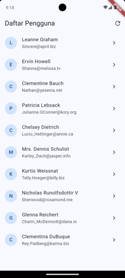
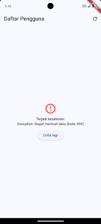
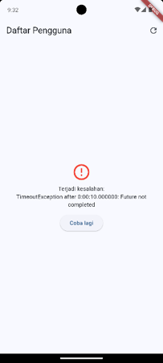
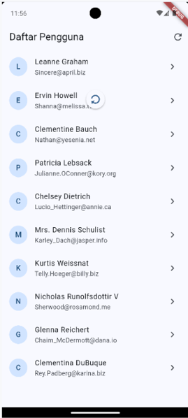
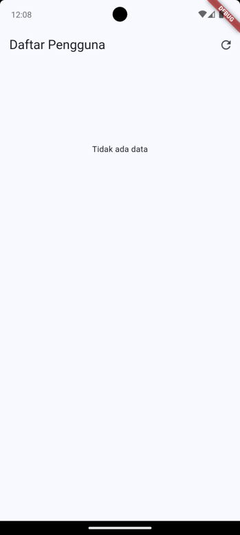

# Praktikum 4 - Mengambil Data dari REST API

Praktikum Flutter Fundamental, Pertemuan 4: **HTTP, Async, dan FutureBuilder**.

- **Nama:** Bagas Yoas Sibagariang
- **NIM:** 20230801254
- **MatKul:** Pemrograman Mobile

## Tujuan

- Memahami pemrograman asinkron di Dart (`Future`, `async`, `await`).
- Mengambil data dari REST API memakai paket `http` dan menguraikan JSON.
- Membuat class model dengan konstruktor `fromJson`.
- Menampilkan data asinkron dengan `FutureBuilder` (status loading, error, dan data).
- Menangani kegagalan jaringan dan menyediakan tombol **Coba lagi**.

## API yang Digunakan

[JSONPlaceholder](https://jsonplaceholder.typicode.com) - endpoint `GET /users`.

## Cara Menjalankan

```bash
flutter create praktikum_4
cd praktikum_4
flutter pub add http
flutter run
```

Ganti isi `lib/main.dart` dengan kode praktikum, lalu jalankan di emulator/perangkat.

Untuk build release Android, pastikan izin internet ada di `android/app/src/main/AndroidManifest.xml` (di atas tag `<application`):

```xml
<uses-permission android:name="android.permission.INTERNET"/>
```

## Isi Praktikum

| Bagian | Isi |
|--------|-----|
| A | Mengenal `Future` dan `FutureBuilder` (simulasi `Future.delayed` 2 detik) |
| B | Menyiapkan paket `http` dan izin internet |
| C | Model `Pengguna` dengan `fromJson` dan fungsi `ambilPengguna()` |
| D | Halaman daftar pengguna dengan `FutureBuilder` (loading, error + tombol Coba lagi, data) |
| E | Halaman detail pengguna |
| F | Percobaan penanganan galat |

> Catatan: `Future` dibuat di `initState()`, bukan di dalam `build()`, agar tidak dipanggil ulang setiap layar dibangun ulang.

## Bagian F - Percobaan Penanganan Galat

| Percobaan | Cara | Hasil yang diamati |
|-----------|------|--------------------|
| 1. URL salah | Ubah `/users` menjadi `/userz`, tekan refresh | Muncul galat `Gagal memuat data (kode 404)` dan tombol Coba lagi |
| 2. Internet mati | Matikan koneksi, tekan refresh | Muncul galat jaringan (mis. `SocketException: Failed host lookup`) dan tombol Coba lagi |

Screenshot:

| Daftar | Galat 404: | Galat jaringan |
|------------------|------------------|-------------------|
|  |  |  |

## Latihan Mandiri

1. **Kolom `username` dan `kota`.** Model `Pengguna` ditambah `username` dan `kota`. Kota diambil dari data bersarang `json['address']['city']`, lalu keduanya ditampilkan di halaman detail.
2. **`RefreshIndicator`.** `ListView` dibungkus `RefreshIndicator` (dengan `AlwaysScrollableScrollPhysics`) agar daftar bisa ditarik ke bawah untuk memuat ulang.
3. **Daftar kosong.** Bila data kosong, ditampilkan teks "Tidak ada data" (dibungkus `ListView` agar tarik-untuk-muat-ulang tetap berfungsi).
4. **Jumlah pengguna di AppBar.** Judul AppBar menampilkan jumlah pengguna setelah data berhasil dimuat, misalnya `Daftar Pengguna (10)`.

Screenshot:
| Halaman detail (username dan kota)| Tarik untuk memuat ulang | Daftar kosong | Judul AppBar dengan jumlah |
|------------------|-------------------|-------------------|-------------------|
|  |  |  |  |


## Jawaban Pertanyaan Refleksi

1. **Future dibuat di `build()`?** Setiap kali layar dibangun ulang, permintaan ke API dikirim lagi sehingga data dimuat berulang dan muncul loading terus-menerus. Karena itu `Future` dibuat di `initState()`.
2. **`snapshot.hasError` vs `response.statusCode`?** `statusCode` memeriksa jawaban server (mis. 404, 500), sedangkan `hasError` menangkap semua galat, termasuk saat permintaan tidak sampai ke server (tanpa internet). Keduanya diperlukan karena kegagalan bisa datang dari dua sumber itu.
3. **Mengapa pakai class model?** Lebih aman (tipe data jelas dan diperiksa saat kompilasi), lebih rapi, dan mengurangi salah ketik kunci JSON dibanding memakai `Map` langsung.
4. **Mengapa perlu status loading dan error?** Pengambilan data butuh waktu dan bisa gagal. Tanpa kedua status itu, pengguna melihat layar kosong atau aplikasi tampak macet tanpa penjelasan.

## Referensi

- [Fetch data from the internet](https://docs.flutter.dev/cookbook/networking/fetch-data)
- [Async dan await di Dart](https://dart.dev/codelabs/async-await)
- [Paket http](https://pub.dev/packages/http)
- [JSONPlaceholder](https://jsonplaceholder.typicode.com)