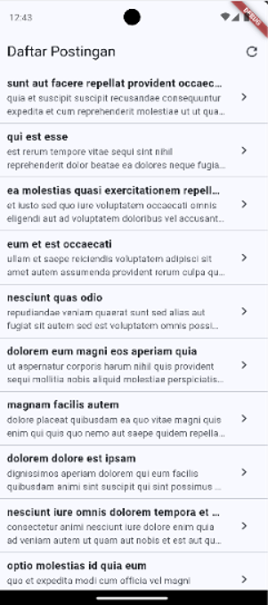
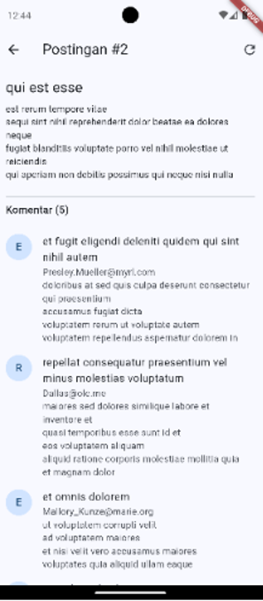
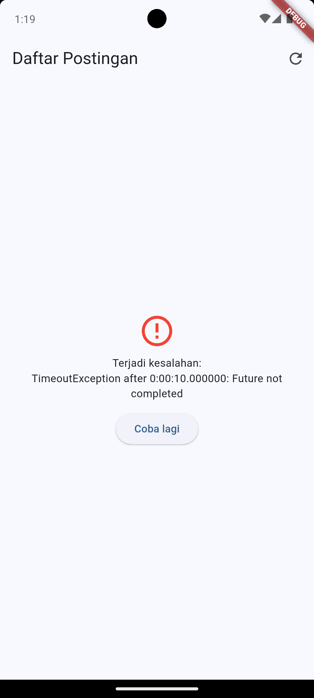
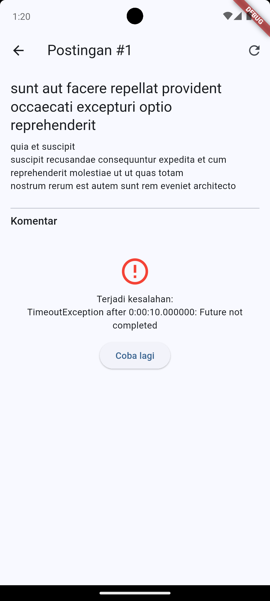

# Tugas 4 - Aplikasi Daftar Postingan

Tugas Flutter Fundamental, Pertemuan 4: mengambil data dari REST API dengan **HTTP, Async, dan FutureBuilder**.

- **Nama:** Bagas Yoas Sibagariang
- **NIM:** 20230801254
- **MatKul:** Pemrograman Mobile

## Deskripsi

Aplikasi menampilkan daftar postingan dari [JSONPlaceholder](https://jsonplaceholder.typicode.com). Mengetuk sebuah postingan membuka halaman detail berisi isi lengkap dan daftar komentar yang diambil dari endpoint terpisah.

## Endpoint

| Kegunaan | Endpoint |
|----------|----------|
| Daftar postingan | `GET /posts` |
| Komentar sebuah postingan | `GET /posts/{id}/comments` |

## Fitur

- Halaman utama menampilkan judul dan potongan isi postingan memakai `FutureBuilder`.
- Halaman detail menampilkan isi lengkap postingan dan daftar komentar (Future kedua dari endpoint terpisah).
- Model `Post` dan `Komentar` dengan `fromJson`.
- Kode pengambil data dipisah dari kode UI (class `PostService`).
- Status **loading** dan **galat** ditangani di kedua halaman, lengkap dengan tombol **Coba lagi**.
- Tombol refresh di AppBar pada kedua halaman.

## Struktur Kode (`lib/main.dart`)

| Bagian | Isi |
|--------|-----|
| Model | `Post`, `Komentar` |
| Layanan | `PostService` (`ambilPosts()`, `ambilKomentar(postId)`) |
| UI | `PostListPage`, `PostDetailPage`, `TampilanError` |

## Cara Menjalankan

```bash
flutter pub get
flutter run
```

Paket yang dipakai: `http` (tambahkan dengan `flutter pub add http` bila belum ada). Pastikan perangkat terhubung ke internet.

## Screenshot

| Daftar Postingan | Detail + Komentar |
|------------------|-------------------|
|  |  |

| Galat di Halaman Daftar | Galat di Halaman Detail |
|-------------------------|-------------------------|
|  |  |

> Galat dihasilkan dengan mengubah sementara URL (mis. `/postz`) atau mematikan internet, lalu menekan refresh.

## Referensi

- [Fetch data from the internet](https://docs.flutter.dev/cookbook/networking/fetch-data)
- [Async dan await di Dart](https://dart.dev/codelabs/async-await)
- [Paket http](https://pub.dev/packages/http)
- [JSONPlaceholder](https://jsonplaceholder.typicode.com)