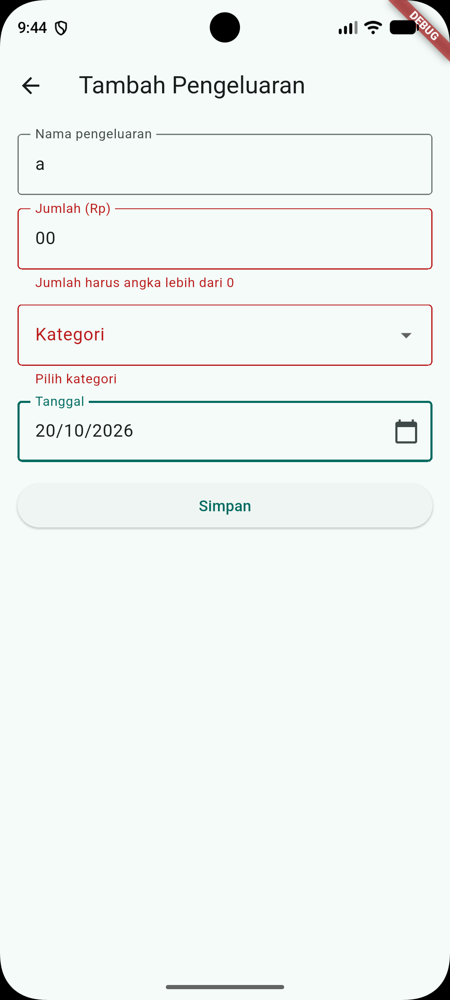
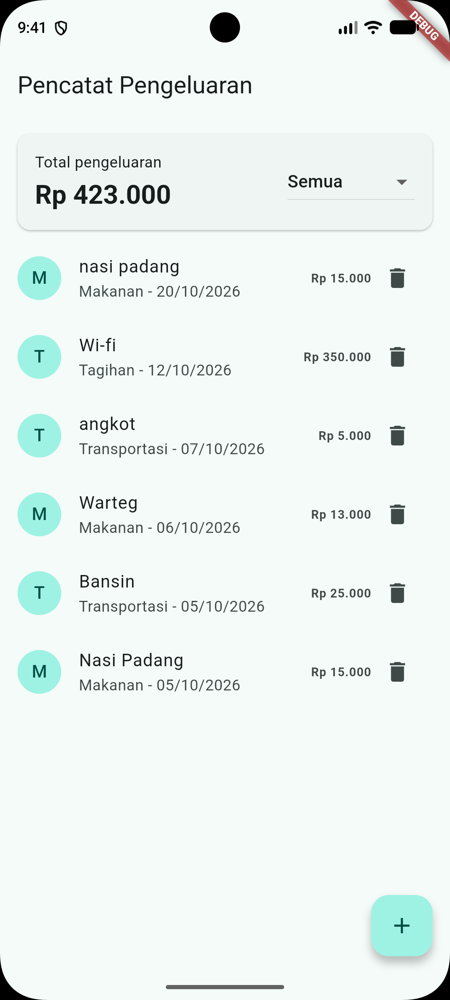

# Tugas 5 - Aplikasi Pencatat Pengeluaran

Tugas Flutter Fundamental, Pertemuan 5: penyimpanan lokal dengan **SQLite (sqflite)** dan **SharedPreferences**.

- **Nama:** Bagas Yoas Sibagariang
- **NIM:** 20230801254
- **Mata Kuliah:** Pemrograman Mobile

## Deskripsi

Aplikasi untuk mencatat pengeluaran harian. Data disimpan di SQLite sehingga tetap ada setelah aplikasi ditutup dan dibuka kembali. Filter kategori terakhir disimpan dengan `shared_preferences`.

## Tabel Database

Tabel `pengeluaran`:

| Kolom | Tipe | Keterangan |
|-------|------|------------|
| `id` | INTEGER | Primary key, AUTOINCREMENT |
| `nama` | TEXT | Nama pengeluaran |
| `jumlah` | INTEGER | Nominal dalam rupiah |
| `kategori` | TEXT | Makanan, Transportasi, Belanja, Hiburan, Tagihan, Lainnya |
| `tanggal` | TEXT | Format `yyyy-MM-dd` |

## Fitur

- **CRUD lengkap:** daftar, tambah, ubah (ketuk item), dan hapus (dengan dialog konfirmasi).
- **Validasi form:**
  - Nama wajib diisi.
  - Jumlah harus angka lebih dari 0.
  - Kategori dipilih dari dropdown.
  - Tanggal dipilih lewat date picker.
- **Total pengeluaran** di halaman utama, dihitung dengan `SELECT SUM(jumlah)` dan mengikuti filter yang aktif.
- **Filter kategori** yang pilihan terakhirnya disimpan dengan `shared_preferences`.
- **Data bertahan** setelah aplikasi ditutup dan dibuka kembali.
- Status loading dan galat ditangani, lengkap dengan tombol **Coba lagi**.

## Struktur Kode (`lib/main.dart`)

| Bagian | Isi |
|--------|-----|
| Konstanta dan pembantu | `kDaftarKategori`, `rupiah()`, `keIso()`, `tampilTanggal()` |
| Model | `Pengeluaran` (`toMap`, `fromMap`) |
| Akses data | `DbHelper` (`tambah`, `semua`, `total`, `ubah`, `hapus`) |
| Pengaturan | `Pengaturan` (`bacaFilter`, `simpanFilter`) |
| UI | `DaftarPage`, `FormPage` |

## Cara Menjalankan

```bash
flutter pub add sqflite path shared_preferences
flutter run
```

Jalankan di **emulator/perangkat Android**. sqflite tidak jalan di web, Windows, dan Linux tanpa paket tambahan. Setelah memasang paket baru, **Stop** aplikasi lalu jalankan ulang.

## Screenshot

| Daftar dan Total | Form Tambah/Ubah |
|------------------|------------------|
|  |  |

| Validasi Form | Data Bertahan Setelah Restart |
|---------------|-------------------------------|
|  |  |

> Bukti data bertahan: hentikan aplikasi sepenuhnya (Stop), jalankan lagi, lalu daftar dan filter terakhir masih sama.

## Referensi

- [Membaca dan menulis SQLite](https://docs.flutter.dev/cookbook/persistence/sqlite)
- [Menyimpan data key-value](https://docs.flutter.dev/cookbook/persistence/key-value)
- [Paket sqflite](https://pub.dev/packages/sqflite)
- [Paket shared_preferences](https://pub.dev/packages/shared_preferences)