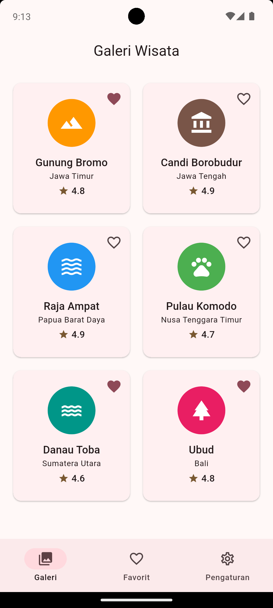
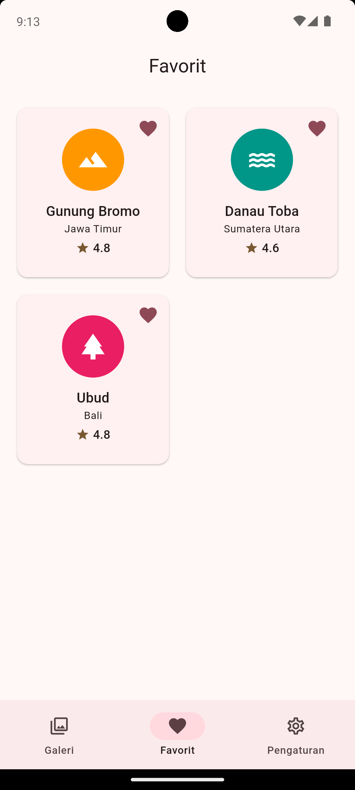
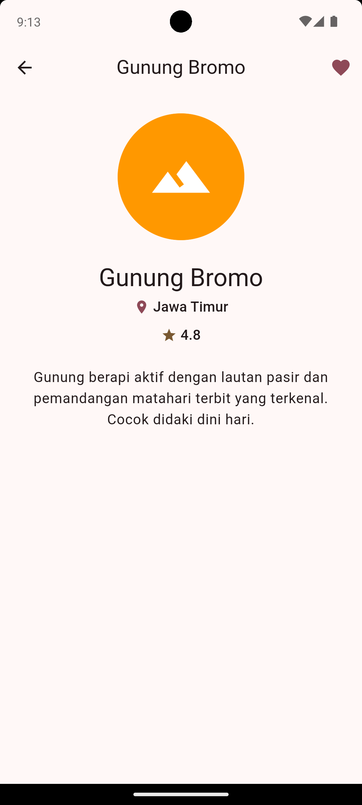
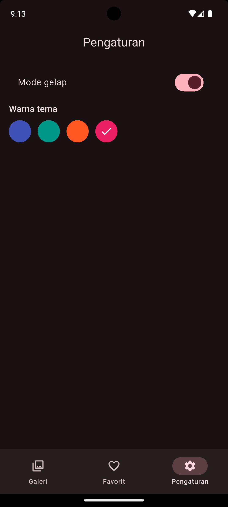

# Tugas 6 — Galeri Wisata Indonesia (Katalog Interaktif)

**Mata kuliah:** Pemrograman Mobile (Flutter Fundamental)
**Pertemuan:** 6 — Tema, Routing dan Navigasi, serta Animasi
**Nama / NIM:** _(isi di sini)_

Aplikasi katalog tempat wisata Indonesia dengan tampilan galeri, daftar favorit, pengaturan tema, halaman detail, dan animasi. Aplikasi ini menjadi bahan awal untuk mini proyek di Pertemuan 7.

---

## Daftar Isi

1. [Fitur](#1-fitur)
2. [Pemenuhan Ketentuan Tugas](#2-pemenuhan-ketentuan-tugas)
3. [Cara Menjalankan](#3-cara-menjalankan)
4. [Struktur Aplikasi](#4-struktur-aplikasi)
5. [Penjelasan Per Bagian](#5-penjelasan-per-bagian)
6. [Keputusan Desain](#6-keputusan-desain)
7. [Tangkapan Layar](#7-tangkapan-layar)
8. [Rencana Pengembangan](#8-rencana-pengembangan)

---

## 1. Fitur

- **Galeri** enam tempat wisata dalam kisi dua kolom, lengkap dengan lokasi dan rating.
- **Halaman detail** dengan ikon yang "terbang" (Hero) dari kartu, animasi masuk berurutan, dan deskripsi tempat.
- **Favorit:** tombol hati pada kartu dan halaman detail, ditampilkan dalam tab Favorit.
- **Pengaturan tema:** mode terang/gelap dan empat pilihan warna.
- **Penyimpanan lokal:** tema dan favorit tetap tersimpan setelah aplikasi ditutup.
- **Halaman 404** untuk rute yang tidak terdaftar.

---

## 2. Pemenuhan Ketentuan Tugas

| Ketentuan | Implementasi | Lokasi di kode |
|---|---|---|
| Minimal 3 tab memakai `NavigationBar` | Galeri, Favorit, Pengaturan | `ShellPage` |
| Named routes dengan argumen untuk halaman detail | `Navigator.pushNamed(context, '/detail', arguments: tempat)` ditangani `onGenerateRoute` | `MyApp`, `KartuTempat` |
| Halaman detail memakai Hero | Tag `'tempat-${id}'` pada avatar di kartu dan di detail | `KartuTempat`, `DetailPage` |
| Animasi implisit | `AnimatedSwitcher` pada ikon hati (kosong ↔ penuh) | `TombolFavorit` |
| Animasi eksplisit (`AnimationController`) | Animasi masuk berurutan di halaman detail memakai `Interval`, `FadeTransition`, dan `SlideTransition` | `_DetailPageState` |
| Tema terang/gelap dan minimal 3 warna | Saklar mode gelap dan 4 pilihan warna | `PengaturanTab`, `buatTema` |
| Tema tersimpan setelah aplikasi ditutup | `shared_preferences`, dimuat di `main()` | `main()` |
| Warna dan gaya teks dari `Theme.of(context)` | Semua teks memakai `textTheme`; latar dan aksen memakai `colorScheme` | Seluruh widget |
| Kumpulkan: tangkapan layar dan kode | Lihat bagian [Tangkapan Layar](#7-tangkapan-layar) | — |

**Bonus dari Latihan Mandiri:** transisi `FadeTransition` pada halaman detail (`PageRouteBuilder`) dan halaman 404 (`onUnknownRoute`).

---

## 3. Cara Menjalankan

```bash
flutter create tugas_6
cd tugas_6
flutter pub add shared_preferences
# ganti isi lib/main.dart dengan kode tugas
flutter run
```

Setelah menambah paket `shared_preferences`, jalankan ulang aplikasi sepenuhnya (bukan hot reload).

---

## 4. Struktur Aplikasi

Seluruh kode berada dalam `lib/main.dart`, disusun dengan pemisah komentar:

```
main.dart
├── TEMA            themeMode, seedColor, pilihanWarna, buatTema()
├── FAVORIT         favorit (ValueNotifier<Set<String>>), toggleFavorit()
├── main()          memuat dan menyimpan tema + favorit
├── DATA            class Tempat, daftarTempat
├── MyApp           MaterialApp, routes, onGenerateRoute, onUnknownRoute
├── ShellPage       Scaffold + NavigationBar + IndexedStack (3 tab)
│   ├── GaleriTab       GridView + KartuTempat
│   ├── FavoritTab      daftar tempat yang difavoritkan
│   └── PengaturanTab   saklar mode gelap + pilihan warna
├── TombolFavorit   ikon hati dengan AnimatedSwitcher
├── DetailPage      Hero + animasi masuk (AnimationController)
└── HalamanTidakDitemukan   halaman 404
```

**Alur navigasi**

```
'/'  ──► ShellPage ──┬─ Tab Galeri ───ketuk kartu───► '/detail' (argumen: Tempat)
                     ├─ Tab Favorit ──ketuk kartu───► '/detail'
                     └─ Tab Pengaturan
rute lain ──► onUnknownRoute ──► HalamanTidakDitemukan
```

---

## 5. Penjelasan Per Bagian

### 5.1 Tema dan Penyimpanan

```dart
final themeMode = ValueNotifier<ThemeMode>(ThemeMode.light);
final seedColor = ValueNotifier<Color>(Colors.indigo);
```

Pilihan tema disimpan di dua `ValueNotifier` global. `MyApp` dibungkus `ListenableBuilder` yang mendengarkan keduanya, sehingga `MaterialApp` dibangun ulang saat salah satu berubah. `ThemeData` dibuat dari satu warna `colorSchemeSeed`; Material 3 menghasilkan seluruh palet.

Di `main()`, nilai tersimpan dimuat dari `SharedPreferences` **sebelum** `runApp`, lalu `addListener` menyimpan setiap perubahan secara otomatis. Warna disimpan sebagai indeks di `pilihanWarna`, karena `SharedPreferences` tidak dapat menyimpan objek `Color`.

### 5.2 Data

```dart
class Tempat {
  final String id;         // juga dipakai sebagai tag Hero dan kunci favorit
  final String nama;
  final String lokasi;
  final String deskripsi;
  final IconData ikon;
  final Color warna;       // warna aksen tempat (bagian dari data)
  final double rating;
}
```

Enam tempat: Gunung Bromo, Candi Borobudur, Raja Ampat, Pulau Komodo, Danau Toba, dan Ubud. Tema dapat diganti (profil diri atau katalog produk) cukup dengan mengubah `daftarTempat`.

### 5.3 Routing dan Hero

`'/'` didaftarkan di `routes`. Halaman `'/detail'` membawa argumen sehingga ditangani `onGenerateRoute`, yang mengubah `settings.arguments` menjadi `Tempat` di satu tempat dan membuat `PageRouteBuilder` dengan `FadeTransition`.

Hero memakai tag `'tempat-${id}'`. Nilai `id` unik untuk tiap tempat, sehingga tidak ada tag ganda dalam satu halaman.

### 5.4 Navigasi Tab

`ShellPage` memegang satu `Scaffold` dengan `NavigationBar` dan `IndexedStack`. `IndexedStack` membuat ketiga tab tetap hidup saat berpindah, sehingga state tiap tab terjaga.

### 5.5 Favorit

```dart
final favorit = ValueNotifier<Set<String>>({});

void toggleFavorit(String id) {
  final baru = {...favorit.value};
  if (!baru.remove(id)) baru.add(id);
  favorit.value = baru;
}
```

Yang disimpan adalah id tempat, bukan objek. `toggleFavorit` membuat **Set baru** setiap kali, karena `ValueNotifier` hanya memberi tahu pendengar bila objeknya berganti; mengubah Set lama secara langsung tidak akan memperbarui layar.

`TombolFavorit`, `FavoritTab`, dan `DetailPage` mendengarkan notifier yang sama lewat `ValueListenableBuilder`, sehingga menekan hati di mana pun memperbarui semuanya sekaligus tanpa `setState`. Daftar favorit disimpan sebagai `List<String>` di `SharedPreferences`.

### 5.6 Animasi Implisit — Tombol Hati

```dart
AnimatedSwitcher(
  duration: const Duration(milliseconds: 300),
  transitionBuilder: (child, anim) => ScaleTransition(scale: anim, child: child),
  child: Icon(
    suka ? Icons.favorite : Icons.favorite_border,
    key: ValueKey(suka),
    color: suka ? warna.primary : null,
  ),
)
```

Ikon hati kosong berganti hati penuh dengan efek membesar. `key: ValueKey(suka)` wajib agar kedua keadaan dianggap widget berbeda dan animasi berjalan.

### 5.7 Animasi Eksplisit — Masuk Berurutan di Detail

```dart
_kontrol = AnimationController(
  vsync: this,
  duration: const Duration(milliseconds: 1000),
)..forward();

_animInfo = CurvedAnimation(
  parent: _kontrol,
  curve: const Interval(0.0, 0.6, curve: Curves.easeOut),
);
_animDeskripsi = CurvedAnimation(
  parent: _kontrol,
  curve: const Interval(0.4, 1.0, curve: Curves.easeOut),
);
```

Satu controller dipecah dengan `Interval`: judul, lokasi, dan rating muncul pada 0–60% waktu, deskripsi menyusul pada 40–100%. Setiap elemen dibungkus `FadeTransition` dan `SlideTransition` (naik sedikit sambil memudar masuk). Controller dibuang di `dispose()`.

### 5.8 Halaman 404

`onGenerateRoute` mengembalikan `null` untuk rute yang tidak dikenal, sehingga Flutter memanggil `onUnknownRoute`, yang menampilkan `HalamanTidakDitemukan` lengkap dengan nama rute yang salah.

---

## 6. Keputusan Desain

**Warna dari tema, kecuali warna data.** Semua teks, latar, dan aksen antarmuka diambil dari `Theme.of(context)` (`textTheme` dan `colorScheme`), sehingga seluruh aplikasi ikut berubah saat mode gelap atau warna tema diganti. Pengecualiannya adalah `Tempat.warna` dan `Colors.white` untuk ikon di atas avatar berwarna: warna ini adalah bagian dari data tiap tempat (identitas visual), bukan gaya antarmuka.

**Tag Hero tidak boleh ganda dalam satu halaman.** Tab Galeri dan Favorit hidup bersamaan di `IndexedStack`. Jika keduanya memakai tag yang sama, Flutter melaporkan error `multiple heroes that share the same tag`. Karena itu `KartuTempat` memiliki parameter `pakaiHero`: kartu di Galeri memakainya, kartu di Favorit tidak. Akibatnya, dari tab Favorit halaman detail hanya memudar tanpa efek ikon terbang.

**Menyimpan id, bukan objek.** Favorit disimpan sebagai himpunan id sehingga ringan, mudah disimpan, dan tidak menduplikasi data tempat.

**Satu berkas.** Untuk tugas ini seluruh kode berada di `main.dart` agar mudah ditelusuri. Pada mini proyek, kode akan dipecah per berkas.

---

## 7. Tangkapan Layar

Letakkan berkas gambar di folder `screenshots/` lalu tampilkan di sini.

| Halaman Galeri | Halaman Favorit | Halaman detail | Halaman Pengaturan |
|---|---|---|---|
|  |  |  |  |

Cara mengambil: tombol kamera pada panel emulator, atau `flutter screenshot -o screenshots/1_terang.png` saat aplikasi berjalan.

---

## 8. Rencana Pengembangan

Bahan awal untuk mini proyek Pertemuan 7:

- Memecah `main.dart` menjadi folder `models/`, `pages/`, `widgets/`, dan `theme/`.
- Mengganti ikon dengan gambar asli (`Image.asset` atau `Image.network`).
- Pencarian dan filter berdasarkan daerah atau rating.
- Mengambil data dari API atau database lokal.
- Pindah ke `go_router` untuk deep link.